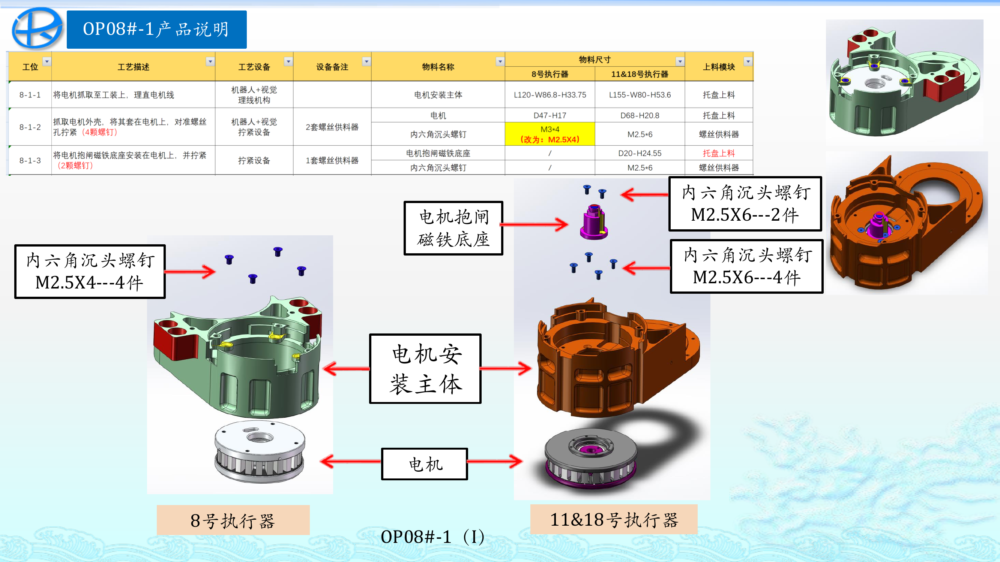
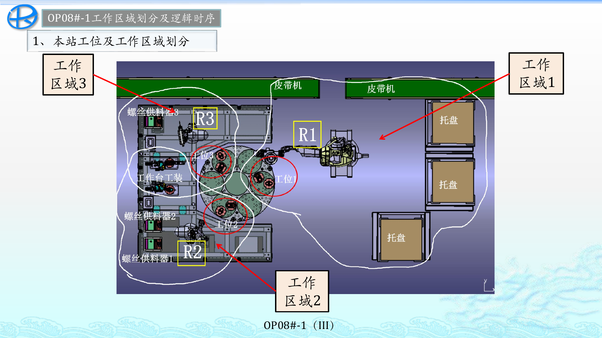
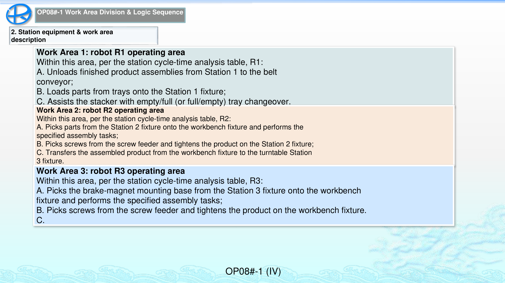
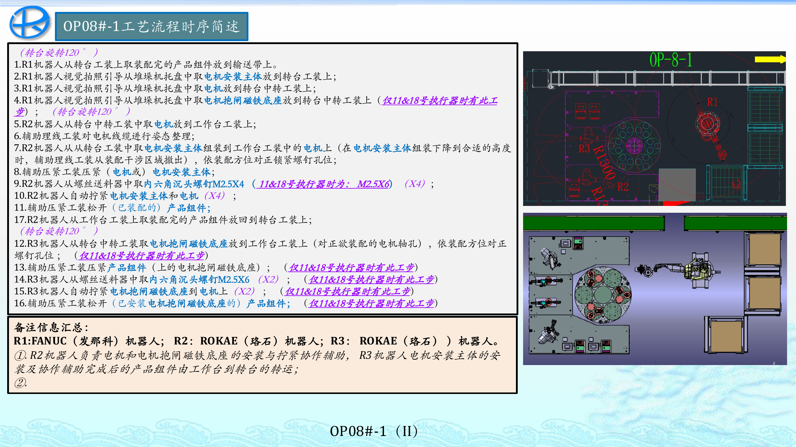
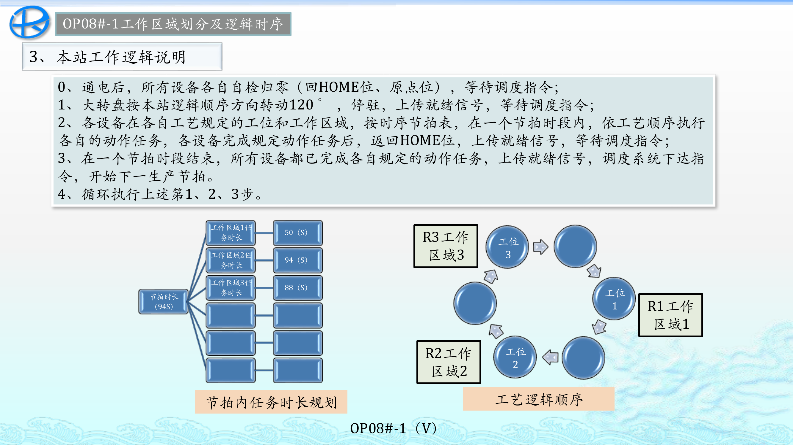

# Process Flow

> OP08#-1 Harmonic Reducer Actuator Motor Assembly -- 17-Step Sequence

This document describes the complete step-by-step assembly process for the OP08#-1 workstation, including cycle time analysis, turntable indexing logic, and product variant handling.

---

## Table of Contents

- [Process Overview](#process-overview)
- [Assembly Sequence](#assembly-sequence)
- [Zone 1 -- R1 Material Handling](#zone-1----r1-material-handling)
- [Zone 2 -- R2 Motor Assembly](#zone-2----r2-motor-assembly)
- [Zone 3 -- R3 Brake Magnet Assembly](#zone-3----r3-brake-magnet-assembly)
- [Cycle Time Analysis](#cycle-time-analysis)
- [Turntable Indexing Logic](#turntable-indexing-logic)
- [Product Variant Handling](#product-variant-handling)
- [Error Recovery](#error-recovery)
- [Source Interpretation Notes](#source-interpretation-notes)
- [Design Assumptions](#design-assumptions)

---

## Process Overview

The OP08#-1 workstation assembles harmonic reducer actuator motors (motor + motor mounting body, plus a brake magnet base for Actuator #11&#18) in a 3-zone process around a 120-degree indexed turntable, with a 94-second takt time. The source deck fixes the product data, the 17-step sequence, the work-area duties and the zone times (50 / 94 / 88 s); everything finer than that in this document is an engineering estimate (see [Design Assumptions](#design-assumptions)).

### Product Variants

| Variant | Motor mounting body | Motor | Motor-mount screws (x4) | Brake magnet base | Brake base screws | Steps |
|:--------|:--------------------|:------|:------------------------|:------------------|:------------------|:------|
| **Actuator #8** | L120 x W86.8 x H33.75 mm | 40 mm amorphous motor (D47 x H17) | M2.5x4 hex socket countersunk (process card originally M3x4; non-standard head dia 4.6 mm) | None | None | 1-11, 17 |
| **Actuator #11&#18** | L155 x W80 x H53.6 mm | 60 mm amorphous axial motor (D68 x H20.8) | M2.5x6 hex socket countersunk (head dia 5.6 mm) | D20 x H24.55 mm | M2.5x6 x2 | 1-17 (all) |

<p align="center">
  
</p>
<p align="center"><em>Source page I: product description. The #8 screw was changed from M3x4 to M2.5x4; the #11&#18 motor-mount screw is M2.5x6.</em></p>

### Components Per Assembly

| Component | Source | Handling |
|:----------|:-------|:---------|
| Motor mounting body | Box stacker 1 (tray feeding) | R1 vision-guided pick from structured tray |
| Amorphous motor (40 mm or 60 mm) | Box stacker 2 (tray feeding) | R1 vision-guided pick from structured tray |
| Motor brake magnet base (#11&#18 only) | Box stacker 3 (tray feeding) | R1 vision-guided pick from structured tray |
| Hex socket countersunk screws M2.5x4 (#8 motor mount) | Screw feeder 1 (at R2) | R2 automatic pick |
| Hex socket countersunk screws M2.5x6 (#11&#18 motor mount) | Screw feeder 2 (at R2) | R2 automatic pick |
| Hex socket countersunk screws M2.5x6 (brake magnet base) | Screw feeder 3 (at R3) | R3 automatic pick |

The source gives 3 box stackers and 15 trays in total, and places feeders 1 and 2 in R2's work area and feeder 3 in R3's. Which stacker holds which part, and which of the two R2 feeders holds which screw, is this repository's assignment.

### Work-Area Duties (source)

| Area | Robot | Duties |
|:-----|:------|:-------|
| Work Area 1 | R1 (FANUC) | A. Unload finished assemblies from Station 1 to the belt conveyor. B. Load parts from trays onto the Station 1 fixture. C. Assist the stacker with empty/full tray changeover. |
| Work Area 2 | R2 (ROKAE) | A. Pick parts from the Station 2 fixture onto the workbench fixture and assemble. B. Pick screws from the feeder and tighten. C. Transfer the assembled product from the workbench fixture to the turntable Station 3 fixture. |
| Work Area 3 | R3 (ROKAE) | A. Pick the brake magnet base from the Station 3 fixture onto the workbench fixture and assemble. B. Pick screws from the feeder and tighten on the workbench fixture. |

<p align="center">
  
  
</p>
<p align="center"><em>Source pages III and IV: work areas (R1 right with pallets and conveyors; R2 bottom-left with feeders 1-2; R3 top-left with feeder 3; shared workbench fixture between R2 and R3) and per-robot duties.</em></p>

---

## Assembly Sequence

```mermaid
flowchart TD
    START(["Cycle Start"]) --> CHECK{"Product<br/>variant?"}

    CHECK -->|"#8 or #11&#18"| S1
    
    subgraph Z1["ZONE 1 -- R1 Material Handling (50s)"]
        S1["<b>Step 1</b><br/>R1 picks finished product<br/>from turntable station 1<br/>Places on output conveyor"]
        S2["<b>Step 2</b><br/>R1 vision locates motor mount body<br/>in tray stacker 1<br/>Picks and places to station 1"]
        S3["<b>Step 3</b><br/>R1 vision locates motor<br/>in tray stacker 2<br/>Picks and places to turntable transit"]
        S4{"Variant<br/>#11&#18?"}
        S4Y["<b>Step 4</b><br/>R1 vision locates brake magnet base<br/>in tray stacker 3<br/>Picks and places to turntable transit"]
        S4N["Step 4 skipped<br/>(Actuator #8)"]
    end

    S1 --> S2 --> S3 --> S4
    S4 -->|Yes| S4Y
    S4 -->|No| S4N
    S4Y --> WAIT1
    S4N --> WAIT1

    WAIT1["All 3 zones complete<br/>Turntable rotates 120 deg"] 

    subgraph Z2["ZONE 2 -- R2 Motor Assembly (94s)"]
        S5["<b>Step 5</b><br/>R2 picks motor<br/>from turntable<br/>Places on workbench"]
        S6["<b>Step 6</b><br/>Auxiliary cable-dressing fixture<br/>arranges the motor cables"]
        S7["<b>Step 7</b><br/>R2 picks motor mount body<br/>from turntable, lowers onto motor<br/>(cable fixture retracts)"]
        S8["<b>Step 8</b><br/>Clamp press engages<br/>Motor + mount body compressed"]
        S9["<b>Step 9</b><br/>R2 picks 4x screws<br/>M2.5x4 from feeder 1 (#8)<br/>M2.5x6 from feeder 2 (#11&#18)"]
        S10["<b>Step 10</b><br/>R2 auto-tightens screws<br/>Vision-guided alignment<br/>Torque monitored"]
        S11["<b>Step 11</b><br/>Clamp released<br/>Assembly held by screws"]
    end

    WAIT1 --> S5 --> S6 --> S7 --> S8 --> S9 --> S10 --> S11

    S11 --> WAIT2["All 3 zones complete<br/>Turntable rotates 120 deg"]

    subgraph Z3["ZONE 3 -- R3 Brake Magnet Assembly (88s)"]
        S12_CHK{"Variant<br/>#11&#18?"}
        S12["<b>Step 12</b><br/>R3 picks brake magnet base<br/>from turntable<br/>Places on workbench"]
        S13["<b>Step 13</b><br/>Clamp press engages"]
        S14["<b>Step 14</b><br/>R3 picks 2x M2.5x6 screws<br/>from screw feeder 3"]
        S15["<b>Step 15</b><br/>R3 auto-tightens screws<br/>Torque monitored"]
        S16["<b>Step 16</b><br/>Clamp released"]
        S12_SKIP["Steps 12-16 skipped<br/>(Actuator #8)"]
        S17["<b>Step 17</b><br/>R2 returns finished assembly<br/>workbench -> turntable station 3<br/>(arrives at station 1 for unload)"]
    end

    WAIT2 --> S12_CHK
    S12_CHK -->|Yes| S12 --> S13 --> S14 --> S15 --> S16 --> S17
    S12_CHK -->|No| S12_SKIP --> S17

    S17 --> DONE(["Cycle Complete"])
```



<p align="center">
  
</p>
<p align="center"><em>Source page II: the 17-step sequence. Note that the source prints step 17 between steps 11 and 12; see <a href="#source-interpretation-notes">Source Interpretation Notes</a>.</em></p>

---

## Zone 1 -- R1 Material Handling

**Robot**: FANUC with combo end-effector (vision camera + mechanical gripper + vacuum suction mounted in three directions, quick-changeable)
**Zone task time**: 50 seconds (source; the cycle time is 94 s; per-step times below are estimates)
**Function**: Unload finished product, load raw materials onto turntable station 1, assist the box stackers with empty/full tray changeover

### Step 1: Unload Finished Product

| Parameter | Value |
|:----------|:------|
| **Source** | Turntable station 1 (finished from previous cycle) |
| **Destination** | Output conveyor belt |
| **End-effector** | Mechanical gripper |
| **Time** | ~8 seconds |
| **Sensors** | Proximity sensor confirms part presence on station 1 |

R1 approaches turntable station 1, confirms a finished assembly is present via proximity sensor, grips the assembly, retracts, moves to conveyor belt, and places the assembly on the conveyor.

### Step 2: Load Motor Mount Body

| Parameter | Value |
|:----------|:------|
| **Source** | Tray stacker 1 (structured trays with motor mount bodies) |
| **Destination** | Turntable station 1, sub-plate position A |
| **End-effector** | Vacuum suction (flat top surface) |
| **Vision** | R1 camera: template matching, XY offset + rotation correction |
| **Time** | ~14 seconds |

R1 moves above tray stacker 1, triggers vision acquisition. The vision system locates the motor mount body in the tray (compensating for placement variation), computes XY offset and rotation angle. R1 adjusts approach position, descends, activates vacuum suction, picks the part, moves to turntable station 1, and places it on sub-plate position A.

### Step 3: Load Motor

| Parameter | Value |
|:----------|:------|
| **Source** | Tray stacker 2 (structured trays with motors) |
| **Destination** | Turntable station 1, sub-plate position B (transit) |
| **End-effector** | Mechanical gripper (cylindrical motor body) |
| **Vision** | R1 camera: circular detection, center + orientation |
| **Time** | ~14 seconds |

Similar to Step 2, but R1 uses the mechanical gripper for the cylindrical motor body. Vision detects the circular motor profile and wire harness orientation.

### Step 4: Load Brake Magnet Base (Actuator #11&#18 Only)

| Parameter | Value |
|:----------|:------|
| **Source** | Tray stacker 3 (structured trays with brake magnet bases) |
| **Destination** | Turntable station 1, sub-plate position C (transit) |
| **End-effector** | Vacuum suction |
| **Vision** | R1 camera: rectangular detection, orientation |
| **Time** | ~14 seconds |
| **Condition** | Only executed for Actuator #11&#18 variant |

For Actuator #8, this step is skipped and R1 enters idle/wait state until the turntable rotation window.

---

## Zone 2 -- R2 Motor Assembly

**Robot**: ROKAE (6-axis) with gripper, screw tightening end-effector and tightening camera
**Zone task time**: 94 seconds (source; bottleneck zone that sets the 94 s cycle time; per-step times are estimates)
**Function**: Motor placement, cable dressing, mounting body alignment, 4x screw tightening (M2.5x4 for #8, M2.5x6 for #11&#18), and the final transfer of the finished product to turntable station 3 (step 17)

### Step 5: Pick Motor from Turntable

R2 reaches to turntable station 2 (where the motor was placed by R1 in the previous cycle's Zone 1), picks up the motor using the mechanical gripper, and places it on the dedicated workbench with precise orientation.

**Time**: ~10 seconds

### Step 6: Cable Dressing

The auxiliary cable-dressing fixture (辅助理线工装, listed in the source as a "cable-dressing mechanism") arranges the motor cables while the motor sits on the workbench fixture. This is an automatic fixture, not a manual operation.

**Time**: ~8 seconds

### Step 7: Motor Mount Body Alignment

R2 picks the motor mounting body from turntable station 2, moves it above the motor on the workbench, and lowers it onto the motor. As the body descends to height, the cable-dressing fixture retracts from the interference zone. The screw holes are aligned per the assembly orientation; the R2 tightening camera provides feedback for fine alignment correction.

**Time**: ~12 seconds

### Step 8: Clamp Press

Pneumatic clamp cylinders engage to press the motor mount body firmly against the motor, ensuring proper seating and alignment for screw insertion.

**Time**: ~4 seconds

### Step 9: Screw Pickup

R2 moves to the screw feeder for the active variant: feeder 1 presents M2.5x4 hex socket countersunk screws (Actuator #8), feeder 2 presents M2.5x6 (Actuator #11&#18). R2 picks up 4 screws sequentially.

**Time**: ~16 seconds (4 screws)

### Step 10: Auto-Tighten Screws

R2 moves to each of the 4 screw hole positions on the motor mounting body. The R2 tightening camera detects the exact hole center. R2 inserts and tightens each screw with torque monitoring:

| Parameter | Value |
|:----------|:------|
| **Screw** | M2.5x4 hex socket countersunk (#8) / M2.5x6 (#11&#18) |
| **Quantity** | 4 per assembly |
| **Tightening torque** | 0.30 +/- 0.05 Nm (M2.5x4) / 0.50 +/- 0.08 Nm (M2.5x6) -- design assumption, the source gives no torque values |
| **Angle monitoring** | 90-360 degrees (snug detection) |
| **Strategy** | 2-stage: snug at low speed, final torque at controlled speed |

**Time**: ~40 seconds (4 screws, ~10 seconds each including positioning)

### Step 11: Release Clamp

Pneumatic clamp retracts. The assembled motor + mount body is now held together by the 4 tightened screws.

**Time**: ~4 seconds

---

## Zone 3 -- R3 Brake Magnet Assembly

**Robot**: ROKAE (6-axis) with gripper, screw tightening end-effector and tightening camera
**Zone task time**: 88 seconds (source; includes step 17 in this repository's reading; per-step times are estimates)
**Function**: Brake magnet base assembly (Actuator #11&#18 only), 2x screw tightening

### Step 12: Pick Brake Magnet Base

R3 reaches to the turntable station 3 transfer fixture (where the brake magnet base placed by R1 has arrived), picks it up, and places it on the workbench fixture aligned to the motor shaft hole, with the screw holes aligned per the assembly orientation.

**Condition**: Only for Actuator #11&#18. For Actuator #8, steps 12-16 are skipped entirely and R3 remains in standby.

**Time**: ~14 seconds

### Step 13: Clamp Press

Pneumatic clamp engages to press the brake magnet base against the motor assembly.

**Time**: ~4 seconds

### Step 14: Screw Pickup

R3 moves to screw feeder 3, picks up 2x M2.5x6 hex socket countersunk screws.

**Time**: ~12 seconds

### Step 15: Auto-Tighten Screws

R3 tightens 2 screws with torque monitoring, guided by the R3 tightening camera:

| Parameter | Value |
|:----------|:------|
| **Screw** | M2.5x6 hex socket countersunk |
| **Quantity** | 2 per assembly |
| **Tightening torque** | 0.50 +/- 0.08 Nm -- design assumption, the source gives no torque values |
| **Angle monitoring** | 90-360 degrees |

**Time**: ~40 seconds

### Step 16: Release Clamp

Pneumatic clamp retracts.

**Time**: ~4 seconds

### Step 17: Return Finished Assembly

R2 picks the completed assembly from the shared workbench fixture and places it on the turntable station 3 fixture (source page IV, R2 duty C). On the next turntable rotation this assembly arrives at station 1, where R1 unloads it to the conveyor (step 1 of the next cycle). For Actuator #8 this step follows step 11 directly, so Zone 3 only takes the time of this transfer.

**Time**: ~14 seconds (including the handoff wait on the shared workbench)

---

## Cycle Time Analysis

### Zone Timing Breakdown

| Zone | Robot | Steps | Cycle Time | Utilization |
|:-----|:------|:------|:-----------|:------------|
| Zone 1 | R1 (FANUC) | 1-4 | 50 s | 53% (idle 44 s waiting for turntable) |
| Zone 2 | R2 (ROKAE) | 5-11 | 94 s | 100% (bottleneck) |
| Zone 3 | R3 (ROKAE), R2 for step 17 | 12-17 | 88 s (#11&#18) / ~14 s (#8) | 94% / 15% |

Zone totals (50 / 94 / 88 s) and the 94 s takt are from the source; the per-step split is an estimate.

### Pipelining

All 3 zones operate concurrently on different workpieces:

```
Cycle N:     [--- Zone 1: R1 loads WP(N) ---][wait]
             [------- Zone 2: R2 assembles WP(N-1) -------]  <-- bottleneck
             [------ Zone 3: R3 finishes WP(N-2) ------]

Cycle N+1:   [--- Zone 1: R1 loads WP(N+1) --][wait]
             [------- Zone 2: R2 assembles WP(N) ---------]
             [------ Zone 3: R3 finishes WP(N-1) ------]
```

### Takt Time Calculation

- **Takt time** = max(Zone 1, Zone 2, Zone 3) = max(50, 94, 88) = **94 seconds**
- **Daily throughput** (assuming a 22-hour shift): 22 x 3600 / 94 = **842 units/day**
- **Turntable idle time**: Turntable waits for slowest zone (R2) before rotating
- **Turntable transition time**: ~4.5 seconds (retract, ~2.5 s 120-degree index, lock; not included in zone times)

### Bottleneck Analysis

Zone 2 (R2 motor assembly) is the bottleneck at 94 seconds due to:
1. 4x screw pickup and tightening (~56 seconds total)
2. Vision-guided alignment for each screw hole position
3. Motor mount body alignment with fine positioning

Potential optimizations:
- Dual screw pickup tool to halve screw handling time
- Pre-positioned screw magazine instead of vibratory feeder
- Faster screw tightening spindle with higher approach speed

---

## Turntable Indexing Logic

### Station Work Logic (source)

The source deck defines the station's dispatch model as follows:

0. On power-up, every device self-checks and homes (HOME / origin position), then waits for a dispatch command.
1. The turntable rotates 120 degrees in the station's logical direction, stops, reports ready, and waits for dispatch.
2. Within one cycle, each device executes its tasks in process order in its work area; on completion it returns to HOME, reports ready, and waits.
3. When all devices have completed their tasks and reported ready, the dispatch system commands the next production cycle.
4. Steps 1-3 repeat.

In this repository the "returned to HOME and ready" report is the `Zone_N_Clear` signal, and the PLC acts as the dispatch system.

<p align="center">
  
</p>
<p align="center"><em>Source page V: station work logic, zone task durations (50 / 94 / 88 s) and the Station 1 -> 2 -> 3 process order.</em></p>

### Rotation Conditions

The turntable rotates 120 degrees only when ALL three conditions are met:

1. **Zone 1 complete**: R1 has finished loading all components for the current workpiece
2. **Zone 2 complete**: R2 has finished motor assembly (all 4 screws tightened, clamp released)
3. **Zone 3 complete**: R3 has finished brake magnet assembly (or skipped for Actuator #8)

### Interlock Sequence

```
1. All robots retract to safe positions (outside turntable envelope)
2. Robot "clear" signals confirmed by proximity sensors
3. Turntable rotation servo enabled
4. Rotation command: target = current position + 120 degrees
5. Motion profile: trapezoidal (accel -> cruise -> decel)
6. Position reached within +/- 0.02 degrees
7. Turntable mechanical lock engages (pneumatic pin)
8. Lock confirmed by sensor
9. Robots re-enabled for next zone operations
```

### Timing

| Phase | Duration |
|:------|:---------|
| Robot retract + confirmation | ~1.5 s |
| Turntable rotation (120 deg, 60 deg/s cruise, 120 deg/s^2) | ~2.5 s |
| Mechanical lock engagement | ~0.5 s |
| Total turntable transition | ~4.5 s |

---

## Product Variant Handling

### Changeover Process

Switching between Actuator #8 and #11&#18 requires:

| Change | Automatic | Time |
|:-------|:----------|:-----|
| Recipe selection (HMI) | Yes | ~2 s |
| Turntable sub-plate tooling | Manual (if different fixtures) | ~15 min |
| Tray stacker 3 loading (brake magnet base) | Manual | ~5 min |
| R3 program activation/deactivation | Yes (via recipe) | ~2 s |
| Screw feeder 2 (R2) and feeder 3 (R3) fill (M2.5x6) | Manual (if empty) | ~5 min |
| R2 screw profile M2.5x4 <-> M2.5x6 (feeder 1 <-> feeder 2) | Yes (via recipe) | ~2 s |
| Vision template switch | Automatic (per recipe) | ~2 s |

### Runtime Variant Logic

The PLC main program checks the active recipe variant at the start of each cycle:

- **Actuator #8**: Steps 4, 12-16 are skipped. R3 remains in standby. R2 uses feeder 1 (M2.5x4). Zone 3 time drops to ~14 seconds (step 17 only).
- **Actuator #11&#18**: All 17 steps executed. R2 uses feeder 2 (M2.5x6). Zone 3 time is 88 seconds.

---

## Error Recovery

### Screw Tightening Failure

If a screw fails torque or angle criteria:
1. Screw driver retracts
2. Failed screw is reverse-driven (backed out)
3. New screw picked from feeder
4. Retry tightening (max 2 retries per hole)
5. If 3rd failure: alarm, operator intervention required

### Vision Failure

If part localization or screw hole detection fails:
1. Re-trigger image acquisition (up to 3 retries)
2. If persistent failure: check lighting, clean camera lens
3. Alarm raised after 3 consecutive failures

### Turntable Position Error

If turntable position deviates > 0.05 degrees after indexing:
1. Retry rotation with tighter servo gains
2. If still out of tolerance: alarm, manual re-homing required
3. Mechanical lock sensor must confirm engagement before proceeding

---

## Source Interpretation Notes

The source deck is a solution proposal and is not fully consistent with itself. Where it leaves room for reading, this repository adopts the following:

1. **Step 17 position.** Page II prints step 17 ("R2 returns the assembled product from the workbench fixture to the turntable fixture") textually between step 11 and step 12, before the second turntable rotation, while numbering it 17. This repository treats step 17 as the last step of the cycle, executed after Zone 3 completes (for Actuator #8, directly after step 11). Reason: page IV says R2 places the product on the *Station 3* fixture, and page II step 12 needs the motor assembly on the workbench when R3 fits the brake magnet base.
2. **Who transfers the product.** Page II note (1) says R3 handles "transfer of the finished product from workbench to turntable", while page IV assigns that transfer to R2 (duty C). This repository follows page IV: R2 performs step 17.
3. **Shared workbench vs. zone times.** Pages III and IV show one workbench fixture shared by R2 and R3. With a single fixture, Zone 2 (94 s) and Zone 3 (88 s) cannot both run on the workbench for different workpieces within one 94 s cycle. This repository models a sequential handoff on the workbench (R2 steps 5-11, then R3 steps 12-16, then R2 step 17) and reports the zone times as given by the source; a two-fixture workbench would be the alternative reading.
4. **Zone 1 vs. Zone 3 labels.** The English translation of page III swaps the "Work Area 1" and "Work Area 3" call-outs. The Chinese original (R1 = Area 1 on the right, R3 = Area 3 top-left) and page IV are followed.
5. **Robot axis count.** The generic platform description (page 5) mentions "1-2 four-axis process robots"; the OP-8-1 equipment list (page VI) specifies 2 six-axis ROKAE process robots. The equipment list is followed.

---

## Design Assumptions

Values in this document that are not given by the source deck and are this repository's engineering choices:

| Topic | Assumption | Source basis |
|:------|:-----------|:-------------|
| Per-step times | Estimated split of each zone | Source gives zone totals only: 50 / 94 / 88 s, takt 94 s |
| Tightening torque | M2.5x4: 0.30 +/- 0.05 Nm; M2.5x6: 0.50 +/- 0.08 Nm | None |
| Screw-to-feeder assignment | Feeder 1 = M2.5x4, feeder 2 = M2.5x6 (both at R2); feeder 3 = M2.5x6 (R3) | Source: 2 feeder sets at step 8-1-2, 1 at 8-1-3; 3 feeders total |
| Part-to-stacker assignment | Stacker 1 bodies, 2 motors, 3 brake bases; 5 trays each | Source: 3 box stackers, 15 trays |
| Turntable motion | 60 deg/s, 120 deg/s^2, ~2.5 s index, +/- 0.02 deg | Source: 120-degree indexing only |
| Throughput | 842 units/day at a 22-hour shift | Derived from takt |
| Camera mounting | Tightening cameras on the R2 / R3 screwdriver end-effectors | Source: "tightening vision x2" |
| Error-recovery limits | 2 screw retries, 3 vision retries, 0.05 deg turntable limit | None |
